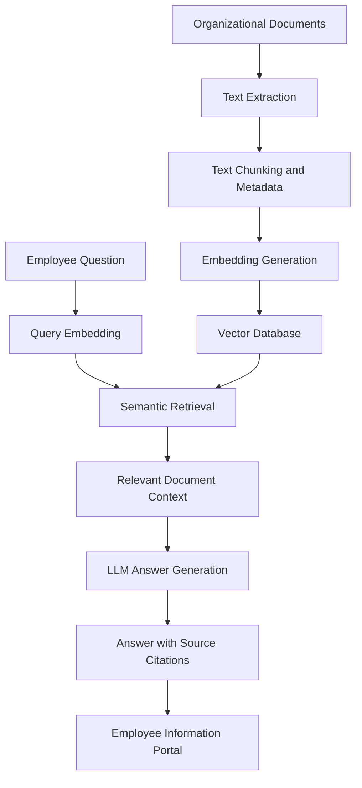

# 🧠 An Intelligent RAG-Based Framework for Employee Information Management and Context-Aware Organizational Decision Support

**Focus Areas:** Artificial Intelligence · Natural Language Processing · Information Retrieval · Organizational Infrastructure

## 📌 Overview

This project proposes an intelligent, Retrieval-Augmented Generation (RAG)-based web application designed to simplify employee information management and organizational knowledge retrieval.

Organizations maintain essential information across multiple documents, including HR policies, leave rules, employee handbooks, onboarding manuals, training materials, and internal guidelines. Finding relevant information manually can be time-consuming and may lead to repetitive queries and difficulty locating the correct policy.

The proposed framework enables employees and HR teams to ask questions in natural language and receive context-aware answers grounded in relevant organizational documents, with source references for verification.

## 🎯 Problem Statement

Traditional employee information management often relies on manually searching multiple documents to find specific organizational policies and guidelines.

This creates several challenges:

- Time-consuming information retrieval.
- Repetitive queries directed to HR teams.
- Difficulty identifying relevant information across multiple documents.
- Risk of receiving incomplete or unsupported answers.
- Limited traceability of information to its original source.

**Research Question:** How can a Retrieval-Augmented Generation framework improve the accessibility, relevance, and reliability of employee information while reducing information retrieval time?

## 💡 Proposed Solution

The proposed system integrates semantic search and Large Language Models (LLMs) into an intelligent employee information portal.

Employees can submit natural-language queries, retrieve relevant document sections, and receive answers generated using the retrieved context.

### 🔄 System Workflow

1. **Document Collection:** Collect organizational documents such as HR policies, leave rules, employee handbooks, and training manuals.
2. **Document Processing:** Extract text, divide it into manageable chunks, and associate relevant metadata.
3. **Embedding Generation:** Convert document chunks into vector representations using a sentence-embedding model.
4. **Semantic Retrieval:** Retrieve the most relevant document sections using vector similarity search.
5. **Context-Aware Generation:** Generate an answer using an LLM, grounded in the retrieved document content.
6. **Source Citation:** Display document references so users can verify the generated answer.
7. **Employee Portal:** Provide a simple web interface for submitting questions and viewing answers.

## 🏗️ System Architecture



## 📝 Example Use Case

**Employee Query:**

> How many days of leave can I take under the company policy?

**System Process:**

- Searches the available organizational documents.
- Retrieves the relevant leave-policy section.
- Generates an answer based on the retrieved content.
- Displays the source document for verification.

**Reliability Principle:** If the available documents do not contain the requested information, the system should clearly indicate that the answer is unavailable instead of inventing a policy.

## 🔬 Research Objectives

The primary objectives of this research are:

- Develop a RAG-based framework for employee information retrieval.
- Investigate the effectiveness of semantic retrieval compared with keyword-based search.
- Evaluate the relevance and accuracy of retrieved document sections.
- Assess whether generated answers are supported by organizational documents.
- Measure retrieval latency and end-to-end response time.
- Analyze the impact of document chunking strategies on retrieval performance.

## 🧪 Experimental Evaluation

A controlled collection of synthetic employee-policy documents can be used to evaluate the proposed framework without accessing confidential organizational information.

| Evaluation Component | Purpose |
|---|---|
| Retrieval Precision@k | Measures the proportion of retrieved results that are relevant |
| Retrieval Recall@k | Measures how many relevant document sections are retrieved |
| Answer Correctness | Evaluates generated answers against manually verified answers |
| Faithfulness | Measures whether answers are supported by retrieved context |
| Response Latency | Measures the time required to retrieve and generate an answer |
| Citation Accuracy | Checks whether source references support the corresponding answers |

### Baseline Comparison

The proposed RAG framework can be compared against a traditional keyword-based search system using the same document collection and test questions.

The experimental results will help determine whether semantic retrieval and context-grounded generation provide measurable benefits.

*Note: Performance improvements and time savings will be reported only after experiments have been conducted.*

## 🛠️ Proposed Technology Stack

| Component | Technology |
|---|---|
| Programming Language | Python |
| Web Interface | Streamlit |
| Embedding Models | Sentence Transformers |
| Vector Database | FAISS or ChromaDB |
| Language Model | LLM API or local language model |
| Document Processing | PyMuPDF or Python document-processing libraries |
| Metadata Storage | SQLite |
| Data Analysis | Pandas, NumPy, Matplotlib |
| Version Control | Git and GitHub |

## 📂 Project Structure

```text
employee-information-rag/
│
├── app.py                  # Streamlit application
├── config.py               # Application configuration
├── requirements.txt        # Python dependencies
│
├── data/
│   ├── documents/          # Sample employee-policy documents
│   └── evaluation/         # Test questions and verified answers
│
├── src/
│   ├── document_loader.py  # Document extraction
│   ├── chunking.py         # Text chunking
│   ├── embeddings.py       # Embedding generation
│   ├── retriever.py        # Relevant document retrieval
│   ├── generator.py        # Context-grounded answer generation
│   └── citations.py        # Source reference handling
│
├── evaluation/
│   ├── keyword_baseline.py # Keyword-search baseline
│   ├── evaluate.py         # Evaluation metrics
│   └── results/            # Experimental results
│
├── tests/                  # Unit and integration tests
├── README.md
└── requirements.txt
```

*This is a suggested structure; files can be added as the implementation progresses.*

## 🚀 Getting Started

### 1. Clone the Repository

```bash
git clone <your-repository-url>
cd employee-information-rag
```

### 2. Create a Virtual Environment

```bash
python -m venv venv
```

Activate the environment on Windows:

```powershell
venv\Scripts\activate
```

### 3. Install Dependencies

```bash
pip install -r requirements.txt
```

### 4. Configure the Application

Configure the selected language model and other required settings using environment variables or Streamlit secrets. Do not commit API keys or other credentials to GitHub.

### 5. Run the Application

```bash
streamlit run app.py
```

*The application will be runnable once the corresponding implementation and configuration are complete.*

## 🌱 Sustainability and Organizational Infrastructure

The project explores how intelligent information retrieval can support more accessible and efficient organizational knowledge management.

Potential applications include:

- Reducing friction in accessing internal organizational knowledge.
- Supporting employee self-service for routine policy questions.
- Improving the traceability of policy-related information.
- Supporting context-aware organizational decision-making.
- Exploring efficient document retrieval as part of digital organizational infrastructure.

Any operational benefits must be validated through appropriate experiments before being reported as research findings.

## 🔐 Privacy and Reliability Considerations

- Use synthetic or publicly available documents during experimentation.
- Avoid uploading confidential employee records to external services.
- Provide source references for generated answers.
- Include a fallback when the retrieved context is insufficient.
- Protect credentials and sensitive application configuration.
- Consider role-based access control before using real organizational documents.

## 📄 Research Contribution

The intended contribution is an experimentally evaluated framework for employee information management that combines semantic document retrieval, context-grounded answer generation, and source citation.

The research will investigate the trade-offs between keyword search and RAG in terms of retrieval quality, answer reliability, citation accuracy, and response latency.

The final contribution will be determined by the implemented method and measured experimental results.

## 🔮 Future Enhancements

- Role-based employee and HR access.
- Support for multiple document formats.
- Improved hybrid retrieval combining keyword and semantic search.
- Document version tracking and policy update detection.
- Multilingual employee queries.
- Feedback-based evaluation of answer usefulness.
- Deployment with appropriate organizational privacy controls.

## 📚 Research Context

**Conference:** ICIDS 2026  
**Theme:** Integrating Technology and Sustainability: Pathways to a Clean Energy Future  
**Relevant Track:** Intelligent Infrastructure: Predictive Analytics and Autonomous Asset Management

The project explores organizational knowledge management as an intelligent infrastructure application. Its relevance to the conference theme will be strengthened by clearly connecting the framework to measurable infrastructure or operational outcomes, rather than relying solely on the use of AI.

---

**Project Status:** Research and development in progress.

**Keywords:** Retrieval-Augmented Generation, Employee Information Management, Natural Language Processing, Semantic Search, Information Retrieval, Large Language Models, Organizational Knowledge Management, Context-Aware Decision Support.
