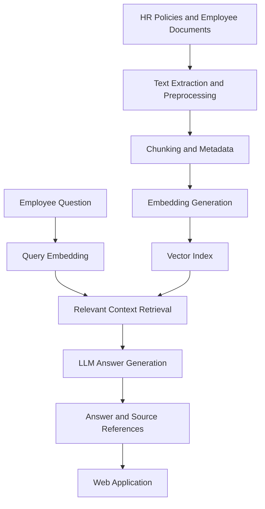

<div align="center">


<br/>

**AI · NLP · Semantic Search · Intelligent Knowledge Management**

<br/>


<br/><br/>

</div>

<p align="center">
  
</p>

<p align="center">
  <b>AI · NLP · Semantic Search · Intelligent Knowledge Management</b>
</p>

<p align="center">
  
  
  
  
</p>

---

### An Intelligent RAG-Based Framework for Context-Aware Organizational Knowledge Retrieval

**AI · NLP · Retrieval-Augmented Generation · Semantic Search · Knowledge Management**

A research-oriented web application that helps employees and HR teams retrieve organizational information using natural-language questions. The proposed system combines semantic document retrieval with Large Language Models (LLMs) to generate context-grounded answers and provide references to the original documents.

> **Research objective:** Investigate whether Retrieval-Augmented Generation can improve employee information retrieval compared with traditional keyword-based search.

## ✨ Key Features

- **Natural-Language Question Answering** — Ask questions about organizational policies in everyday language.
- **Document-Based Retrieval** — Retrieve relevant sections from employee handbooks, HR policies, leave rules, and training materials.
- **Semantic Search** — Identify relevant content using vector embeddings and similarity search.
- **Context-Grounded Responses** — Generate answers using retrieved document context.
- **Source Traceability** — Provide document references to help users verify answers.
- **Fallback for Missing Information** — Indicate when the available documents do not contain sufficient information.
- **Research Evaluation** — Compare retrieval quality, answer reliability, citation accuracy, and response latency against a keyword-search baseline.

*Feature availability depends on the current implementation. Planned features should not be presented as completed functionality.*

## 🎯 Problem Statement

Organizations distribute employee information across multiple documents, including HR policies, leave guidelines, onboarding manuals, training materials, and employee handbooks.

Traditional document-search workflows can require employees to inspect several files manually. This may increase information retrieval effort, generate repetitive HR queries, and make it difficult to identify the exact policy relevant to a question.

**Research question:** How can a RAG-based framework improve the accessibility, relevance, and reliability of employee information while reducing information retrieval time?

## 💡 Proposed Solution

The platform introduces a document-grounded question-answering workflow:

1. Collect organizational documents.
2. Extract and preprocess document text.
3. Split content into manageable chunks.
4. Generate embeddings for semantic representation.
5. Retrieve relevant document sections for a user query.
6. Pass the retrieved context to an LLM.
7. Return an answer with supporting document references.

### 🏗️ System Architecture



## 🔍 Example Use Case

**Question**

“How many days of leave can I take under the company policy?”

**Expected workflow**

- Search the available policy documents.
- Retrieve the relevant leave-policy section.
- Generate a response grounded in the retrieved text.
- Display the source document for verification.

If the available documents do not specify the leave allowance, the system should state that the information could not be found rather than inventing a policy.

## 🛠️ Technology Stack

| Component | Proposed Technology |
|---|---|
| Language | Python |
| Web application | Streamlit |
| Text embeddings | Sentence Transformers |
| Vector search | FAISS or ChromaDB |
| Language model | LLM API or local model |
| Document processing | PyMuPDF and relevant Python libraries |
| Metadata storage | SQLite |
| Evaluation and analysis | Pandas, NumPy, Matplotlib |
| Version control | Git and GitHub |

*These are proposed technologies; update this table to match the libraries actually used in the repository.*

## 🔬 Research Methodology

The research evaluates whether semantic retrieval and context-grounded generation offer measurable benefits over keyword-based search.

### Experimental Design

- **Dataset:** Synthetic employee-policy documents with manually verified answers.
- **Baseline:** Traditional keyword-based retrieval.
- **Proposed approach:** Semantic retrieval combined with RAG.
- **Test queries:** Questions covering policy details, leave rules, onboarding, and information missing from the documents.
- **Comparison:** Evaluate both approaches using the same document collection and question set.

### Evaluation Metrics

| Metric | What It Measures |
|---|---|
| Precision@k | Relevance of retrieved document sections |
| Recall@k | Coverage of relevant document sections |
| Answer correctness | Agreement with manually verified answers |
| Faithfulness | Support provided by retrieved context for generated answers |
| Citation accuracy | Whether cited sources substantiate the answer |
| Response latency | Time required to produce a response |

The experimental results will establish whether the proposed framework improves retrieval and answer quality. No performance improvements or time savings should be claimed before the experiments are completed.

## 📁 Suggested Project Structure

```text
employee-information-rag/
├── app.py
├── config.py
├── requirements.txt
├── README.md
├── data/
│   ├── documents/
│   └── evaluation/
├── src/
│   ├── document_loader.py
│   ├── chunking.py
│   ├── embeddings.py
│   ├── retriever.py
│   ├── generator.py
│   └── citations.py
├── evaluation/
│   ├── keyword_baseline.py
│   ├── evaluate.py
│   └── results/
└── tests/
```

*This structure is a reference design, not a claim that all these files already exist.*

## 🚀 Getting Started

### Prerequisites

- Python 3.10 or a compatible version for the selected dependencies.
- Git.
- Required language-model credentials, if using a hosted API.

### 1. Clone the repository

```bash
git clone <YOUR_REPOSITORY_URL>
cd employee-information-rag
```

### 2. Create a virtual environment

```bash
python -m venv venv
```

On Windows:

```powershell
venv\Scripts\activate
```

### 3. Install dependencies

```bash
pip install -r requirements.txt
```

### 4. Configure credentials

Configure the required model settings using environment variables or Streamlit secrets. Never commit API keys, passwords, or confidential organizational documents.

### 5. Launch the application

```bash
streamlit run app.py
```

Ensure that the application files, dependencies, and configuration are implemented before publishing these commands as verified setup instructions.

## 🔐 Privacy and Reliability

The project should prioritize trustworthy handling of organizational information:

- Use synthetic or public documents for initial experiments.
- Ground generated answers in retrieved evidence.
- Provide source references wherever possible.
- Handle missing or insufficient context explicitly.
- Protect API credentials and sensitive configuration.
- Introduce role-based access controls before handling restricted employee information.

## 🌱 Organizational Infrastructure and Sustainability

The platform explores how intelligent knowledge retrieval can support digital organizational infrastructure by improving access to operational information.

Potential applications include employee self-service, policy discovery, knowledge traceability, and context-aware organizational support.

For alignment with the ICIDS 2026 theme, the research should establish a measurable connection to sustainable or intelligent infrastructure outcomes rather than assuming that the use of AI alone demonstrates sustainability benefits.

## 🔮 Future Scope

- Hybrid retrieval combining keyword search and semantic search.
- Support for additional document formats.
- Policy version tracking and update detection.
- Multilingual employee queries.
- Role-based document access.
- Feedback-driven answer evaluation.
- Improved handling of conflicting or outdated policies.

## 📚 Research Context

**Conference:** ICIDS 2026  
**Theme:** Integrating Technology and Sustainability: Pathways to a Clean Energy Future  
**Relevant track:** Intelligent Infrastructure: Predictive Analytics and Autonomous Asset Management

The project investigates employee information management through intelligent retrieval and context-aware response generation. Its research contribution will be defined by the implemented framework and reproducible experimental findings.

## 📌 Project Status

**Research and development in progress.**

The framework is intended to combine semantic retrieval, context-grounded answer generation, and source traceability in an employee information management application.

## 🏷️ Keywords

`Retrieval-Augmented Generation` `RAG` `Python` `NLP` `Semantic Search` `Information Retrieval` `Large Language Models` `Employee Information Management` `Knowledge Management` `Context-Aware Systems`
